## HELLO!

  

<b>♟️ How Commit Chess works</b>

- Every day with a contribution moves the next pawn one square up the board. On the 8th rank it becomes a queen.
- Promote all 8 pawns to win the board, then a new game begins.
- The chess clock gains **+3:00** for each active day and loses **−10:00** for each idle day. If the flag falls, the board resets.
- The rank of squares under the clock shows the last 14 days, with each day's piece set by its contribution count (♙ 1 · ♘ 3 · ♗ 5 · ♖ 7 · ♕ 10 · ♔ 15+).

Regenerated by [a GitHub Action](./.github/workflows/commit-chess.yml) from the contribution calendar.

